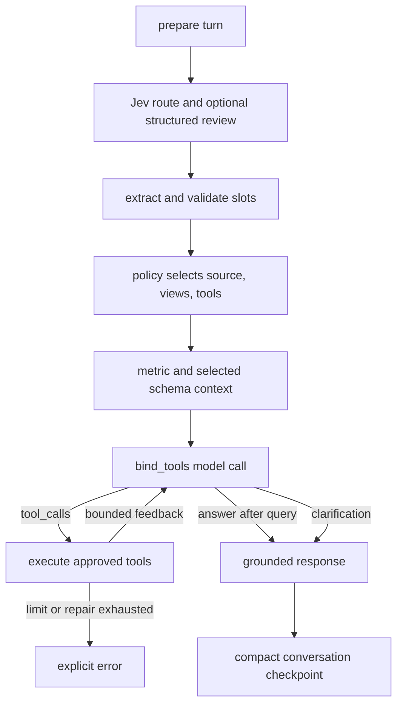

# Controlled function calling (phase 3)

The installed `langchain-openai`/`langchain-core` versions support
`bind_tools`. Each turn builds a registry from the route policy's trusted
`data_source` and `selected_tables`. `StructuredTool` exposes the registry's
Pydantic input models to the generative model. The model returns LangChain
`AIMessage.tool_calls`; Python invokes the registry; `ToolMessage` results go
back to the same bound model. Jev only proposes intent and data scope.

MySQL turns expose `lookup_metric_definition`, `get_mysql_schema`, and
`query_mysql_readonly`. Hive turns expose the lookup tool, `get_hive_schema`,
and `query_hive_readonly`. A model supplied name outside this registry is
rejected. Query tools always run SQLGlot and the turn's view whitelist, read
only check and row cap. The application allows one successful query per turn.
It limits bound model calls to `TOOL_MAX_MODEL_CALLS=6`, total generative calls
to `MODEL_MAX_CALLS_PER_TURN=8`, tool calls to `TOOL_MAX_CALLS=8`, and SQL
repairs to `SQL_MAX_REPAIR_ATTEMPTS` (at most 2). These are configurable except
the one successful query limit. A model response without a query call can only
ask a short clarification question; a statement without a query is an explicit
tool compatibility error.

`tool_transcript`, pending calls, proposed answer and `query_result` are
LangGraph `UntrackedValue` channels. The transcript contains the full
`ToolMessage` query rows during the turn, but SQLite stores only compact
conversation context, counters, route metadata and the final answer summary.
The checkpoint test scans the SQLite bytes for a unique result row marker.

`/api/v1/chat` retains its existing response fields and trace ID audit; tool
counters are additive execution details. The configured `OPENAI_BASE_URL` is
passed only to `ChatOpenAI`. A bound call failure or an unparseable tool call
returns a clear 503 configuration error. Jev uses its separate TypeSafe client.
